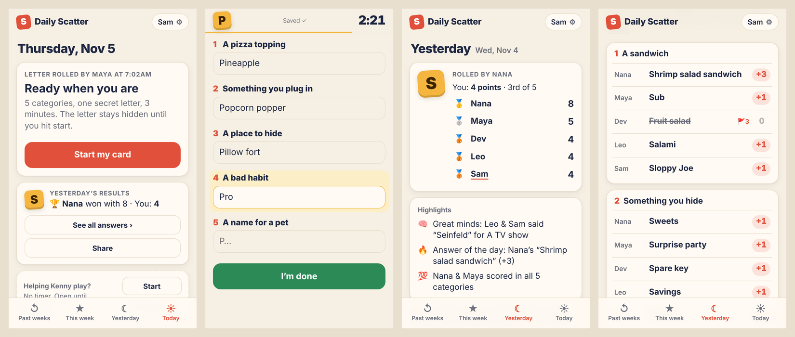

# Daily Scatter

A daily category game for a family or a group of friends, played on your phones. Everyone gets the same five categories and one letter, three minutes on the clock, and the answers come out once the whole group has played. It's Wordle's daily habit with Scattergories' arguments.



It was built for one family (seven players and a dog who judges) and runs for free: a static website on GitHub Pages and a small Firestore database. There's no server and no app store.

- **Want your own?** [Run your own copy](docs/setup.md): about 30 minutes, no coding.
- **Optional extras:** [automatic WhatsApp posts](docs/whatsapp.md) and [a judge bot in the group chat](docs/judge-bot.md).
- **Curious how it works?** See [How it's built](#how-its-built).

Daily Scatter is a homemade game inspired by Scattergories. It isn't affiliated with or endorsed by Hasbro, which owns that name.

## How it plays

- **Every day:** the first person to open the app rolls the letter for everyone. Each card has 5 categories and one letter. The categories and letter stay hidden until you hit **Start**, and then you get **3 minutes**. Answers save as you type and lock when time's up, or when you tap "I'm done."
- **All day:** the card is open until midnight. Before you've played, Today shows the start button first, with a **Yesterday's results** card under it (the winner and your score; tap it to see everyone's answers or to share them). After you've played, it shows the week's standings so far.
- **When everyone's done, or at midnight:** everyone's answers are revealed as soon as the whole family has finished, or at midnight if someone doesn't play. The admin picks who counts as "the family" in ⚙︎ Settings; Kenny is always optional. Until then, Today shows who it's waiting on.
  - An answer that **matches** someone else's on the same category is struck out for everyone who wrote it. Matching ignores capitals, punctuation, accents and a leading "the/a/an."
  - An answer counts if **any of its main words** starts with the letter, so "Eat Pizza" works for P. Little words like "the", "of" and "and" don't count, so "The Godfather" doesn't work for T. This is friendlier than the official rule, where only the first word counts. If no main word starts with the letter, the answer scores 0.
  - You can't use the **same answer twice** on your own card. The box turns red, the repeat is cleared when you leave it, and a repeat would score 0 anyway.
  - Every other answer scores **1 point per word that starts with the letter**, skipping little words like "of" and "and." So "Mickey Mantle" for M is worth 2.
- **Challenges:** anyone can tap an answer to 🚩 **challenge** it, or to say it's **the same as** another answer (say, a typo). If most of the other players who played that day challenge an answer (and at least two do), it's tossed and scores 0, like the vote in the board game. The admin has the last word: − / + sets any answer's points (say "To Tell the Truth" deserves 3), and "same as" suggestions need the admin's OK. In admin mode, Today lists anything waiting for a decision.
- **Yesterday tab:** the bottom bar (right to left, so Today sits under your right thumb: Today · Yesterday · This week · Past weeks) has a **Yesterday** tab that opens everyone's answers from yesterday, from anywhere in the app.
- **Highlights:** each day's results call out the talking points: matching answers ("great minds"), the top-scoring answers, the only person to score in a category, and anyone who scored in all five. They're in the app and in the shared results.
- **Streaks:** play on consecutive days and you get a 🔥 streak, shown next to your name. Missing a day resets it.
- **Hall of fame:** the Past weeks tab starts with all-time records: weeks won, days won, best day, average and longest streak.
- **Weekly:** weeks run Monday to Sunday. Scores reset every Monday, and past weeks (with winners) stay under **Past weeks**.
- **Sharing:** **Share** (at the bottom of any day's results, and the **Share** button next to "Your score yesterday" on Today) opens the iPhone share sheet with the whole day ready to paste into WhatsApp: the standings, every player's answer to every category (matches ~crossed out~, answers with no word starting with the letter marked ✗, admin calls marked ⚖️), and the week so far. If a phone can't open the share sheet, it copies the text instead.

### Kenny's card (playing with a helper)

Players listed in `ASSISTED_PLAYERS` (in `js/config.js`) play with a helper's phone:
- Same screen as a regular card, but with no timer: a green **Kenny mode** tag sits where the clock would be. The helper asks each category out loud and types the answer.
- Answers save as you go, so you can close it and come back later. It has to be done by midnight.
- **Not today 😴** marks a day off. Tap **Actually, let's play** to undo it.
- Kenny has his own page, `kenny.html`, which you can add to the Home Screen as a second icon.

### Adding it to the Home Screen

Open the site in Safari, tap **Share**, then **Add to Home Screen**. For a helper player, open their page (here, `kenny.html`) and do the same. Each icon remembers who it's for.

## Playtest mode

Add `?playtest` to the game's address to practice any time of day:
- **Separate data:** playtest uses its own practice data. Nothing there touches the real game or the real scores.
- **No midnight wait:** tap **Reveal now** in the yellow banner to see results right away.
- **Next day ›** jumps the practice game forward a day, so you can play through a whole week and watch the Monday reset.
- **Exit** returns to the real game. **⚙︎ → Wipe all playtest data** starts the practice over.

Playtest stays on for that phone until you tap Exit. Everyone in playtest shares the same practice game, so you can test with a few family members at once.

## Changing things

| To change... | Edit |
|---|---|
| The family code or admin code | `js/config.js` (it stores a SHA-256 of each; the comment there shows how to make a new one) |
| Timer length | `TIMER_SECONDS` in `js/config.js` |
| Who plays with a helper | `ASSISTED_PLAYERS` in `js/config.js` (each one also needs its own page: copy `kenny.html` and change `data-as`) |
| The categories | `PROMPTS` in `js/prompts.js` |
| Your own name | ⚙︎ → **Change my name** (your scores and streak stay with you) |
| A special card for a birthday or holiday | `SPECIAL_CARDS` in `js/prompts.js` (there's an example in the comments) |
| Which letters can come up | `LETTERS` in `js/prompts.js` |
| The time zone | `TIME_ZONE` in `js/config.js` |

Players switch who they are under ⚙︎ → **Switch player**. The admin unlocks admin mode under ⚙︎ with the admin code.

## How it's built

It's a plain static site with no build step and no dependencies. `index.html` loads `js/app.js` as an ES module. The app talks to Firestore directly over its REST API (no Firebase SDK), which keeps the page small.

| File | What it does |
|---|---|
| `js/app.js` | Screens, routing, the timer and Kenny mode |
| `js/game.js` | Reading and writing game data |
| `js/scoring.js` | All scoring rules (pure functions, unit tested) |
| `js/stats.js` | Highlights, streaks and hall-of-fame records (pure functions, unit tested) |
| `js/reveal.js` | When results come out (midnight, or once the family is done) and quiet hours for posts |
| `js/config.js` | Every setting specific to one group: database, address, time zone, codes |
| `js/time.js` | Days, the midnight close and Monday weeks in the group's time zone, with DST handled |
| `js/share.js` | The text for sharing a day or a week to a group chat |
| `js/prompts.js` | Categories, letters and the daily pick (no category repeats for about 9 weeks) |
| `js/db.js`, `js/codec.js` | Tiny Firestore REST client |

**Data:** there is one document per day, `days/YYYY-MM-DD`. It holds the letter, the prompts, each player's card (`cards.<id>`), and the review maps (`flags`, `merges`, `overrides`). Scores are never stored; every phone works them out from the answers, so a change to the scoring rules applies to old days too. `players/<id>` remembers names for the "Who are you?" buttons.

**About security:** there are no logins. The family code keeps strangers from wandering in. The admin code is checked on the phone. The database rules stop anyone from re-rolling, deleting or adding unexpected data. This is fine for a family game, but it isn't bank-grade security: a determined techie could still edit answers through the API.

**Cost:** a family this size uses a tiny fraction of Firestore's free tier. The game itself has no server. The optional WhatsApp posts run as a scheduled GitHub Actions job (`tools/post-results.mjs`), and the optional judge bot is a Google Apps Script (`tools/sheabot.gs`); both are free.

## Development

Requires Node 18 or later. For the end-to-end test you also need Playwright with Chromium.

```bash
npm test              # unit tests: scoring, time zones, prompts
npm run e2e           # plays several full days on emulated iPhones (screenshots in tests/screens/)
npm run devices       # main screens on 6 iPhone sizes (SE to Pro Max, plus large text), dark mode
npm run poster        # the WhatsApp posting job, through a week of scenarios, against a fake WhatsApp
npm run check         # all of the above; run before every release
npm run doctor        # checks your settings and that the database answers
npm run screens       # regenerates the README picture (docs/screens.png)
npm run serve         # local copy at http://localhost:8080 using an in-memory fake database
```

**Updates reach phones on their own.** An open app checks for a newer version every few minutes and whenever it's reopened, then reloads itself, though never in the middle of a card. ⚙︎ Settings shows the version a phone is running.

**Before every release, run `npm run stamp`.** It puts a fresh version number on every file reference (`?v=…`), so phones download a matching set of new files instead of mixing old cached ones with new ones. A unit test fails if a reference is unstamped or the stamps don't match.

On `localhost`, the app automatically uses the fake database in `tests/server.mjs`, so testing never touches the real one. To test against Google's Firestore emulator (which also enforces `firestore.rules`), start the emulator, then run with `FIRESTORE_EMULATOR_HOST=127.0.0.1:8085`.

## License

[MIT](LICENSE). Use it, change it, run your own.
